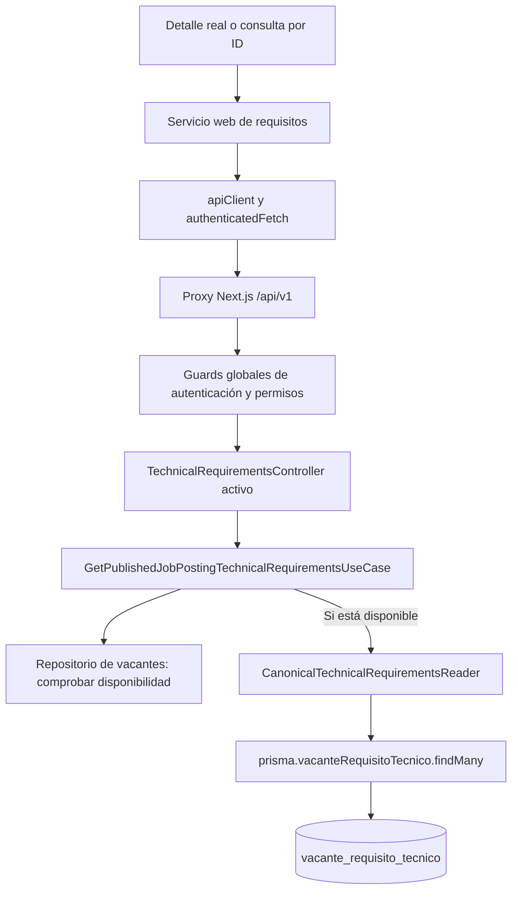

<div align="center">


<br>

<h2>UNIVERSIDAD MAYOR DE SAN SIMÓN</h2>
<p><strong>FACULTAD DE CIENCIAS Y TECNOLOGÍA</strong><br>
DEPARTAMENTO DE INFORMÁTICA – SISTEMAS</p>

<br>

<h1>DOCUMENTACIÓN DE LA HU8</h1>
<h2>Consultar requisitos técnicos de una vacante</h2>

<br>

<p><strong>Ingeniería de Software</strong><br>
Proyecto UMSSPIRA – Epic 5</p>

<br>

<p><strong>Estudiante:</strong> Paul Rodrigo Larico Viscarra<br>
<strong>Docente:</strong> Camacho del Castillo Indira</p>

<br>

<p>Cochabamba – Bolivia<br>
Noviembre de 2026</p>

</div>

---

| Identificación          | Referencia                                                                                                             |
| ----------------------- | ---------------------------------------------------------------------------------------------------------------------- |
| Proyecto                | UMSSPIRA, Universidad Mayor de San Simón                                                                               |
| Historia                | Epic 5 · HU8 – Consultar requisitos técnicos de una vacante                                                            |
| Rama oficial            | `feat/G2-HU8-consultar-requisitos-tecnicos`                                                                            |
| Pull Request            | [PR #687 — Implementación de consulta de requisitos técnicos y pruebas](https://github.com/umsspira/UMSSPIRA/pull/687) |
| Código local examinado  | `605d437247ce4dc890c7bf6a755259108742e320`                                                                             |
| Alcance de este informe | Implementación, integración, pruebas observadas y limitaciones verificables                                            |

**Criterio de evidencia.** La descripción funcional se basa en el código de la revisión indicada y en la documentación del repositorio. Los resultados de ejecución se identifican como históricos o como observados en la sesión de integración previa a esta redacción. No se presentan pruebas simuladas como evidencia de acceso a una base de datos real ni se atribuye al PR un resultado de CI remoto no comprobado.

## Contenido

1. [Introducción](#1-introducción)
2. [Objetivo general y objetivos específicos](#2-objetivo-general-y-objetivos-específicos)
3. [Descripción de HU8 y funcionalidad](#3-descripción-de-hu8-y-funcionalidad)
4. [Criterios de aceptación](#4-criterios-de-aceptación)
5. [Arquitectura y tecnologías utilizadas](#5-arquitectura-y-tecnologías-utilizadas)
6. [Implementación del frontend](#6-implementación-del-frontend)
7. [Implementación del backend](#7-implementación-del-backend)
8. [Rutas del frontend y endpoints del backend](#8-rutas-del-frontend-y-endpoints-del-backend)
9. [Manejo de datos reales y simulados](#9-manejo-de-datos-reales-y-simulados)
10. [Integración y dependencias con otras HUs](#10-integración-y-dependencias-con-otras-hus)
11. [Pruebas realizadas y resultados comprobables](#11-pruebas-realizadas-y-resultados-comprobables)
12. [Problemas encontrados y soluciones aplicadas](#12-problemas-encontrados-y-soluciones-aplicadas)
13. [Estado actual, limitaciones y aspectos pendientes](#13-estado-actual-limitaciones-y-aspectos-pendientes)
14. [Conclusiones](#14-conclusiones)
15. [Referencias al código y al PR #687](#15-referencias-al-código-y-al-pr-687)

---

## 1. Introducción

HU8 permite consultar los requisitos técnicos estructurados de una vacante disponible en la bolsa de trabajo de UMSSPIRA. Su finalidad es que el usuario pueda conocer las competencias solicitadas, el nivel esperado, su carácter obligatorio o deseable y la descripción adicional registrada.

La historia se integra en el listado y en el detalle de vacantes existentes. Conserva la búsqueda, la navegación y la afinidad del sistema, mientras agrega una consulta específica a los requisitos administrados por HU2. También preserva la presentación original de HU8 y una demostración explícita con ejemplos locales.

Este informe complementa [hu8-integracion-epic5.md](../hu8-integracion-epic5.md), [RutasFrontend.md](./RutasFrontend.md) y [RutasBackend.md](./RutasBackend.md). Las dos guías de rutas describen principalmente HU2 y HU10; aquí se documenta el endpoint de lectura específico de HU8 y su integración actual.

**Delimitación de la historia.** El documento `docs/qa-hu8-bloqueos.md` corresponde a otra HU8, de Epic 3, relacionada con Radar y permisos NLP. Sus criterios, permisos y procedimientos operativos no se trasladan a esta HU8 de Epic 5.

## 2. Objetivo general y objetivos específicos

### 2.1. Objetivo general

Facilitar la consulta autenticada de los requisitos técnicos de una vacante disponible mediante una interfaz clara y un servicio de lectura integrado con el contrato canónico de HU2.

### 2.2. Objetivos específicos

- Incorporar la consulta al detalle real de la vacante y mantener la consulta original por ID desde el listado.
- Presentar competencia, nivel esperado, tipo de requisito y descripción cuando corresponda.
- Validar el identificador, la disponibilidad de la vacante y la consistencia de la respuesta recibida.
- Diferenciar carga, colección vacía, recurso no disponible, fallo de conexión y error de consulta.
- Reutilizar autenticación, proxy y manejo de errores del monorepo.
- Mantener separados los requisitos estructurados, las habilidades utilizadas para afinidad y los datos de demostración.
- Preservar los escenarios demo sin utilizarlos como sustitutos de datos reales ante un error.
- Documentar el alcance de las pruebas y las verificaciones pendientes de infraestructura y datos.

## 3. Descripción de HU8 y funcionalidad

### 3.1. Descripción funcional

Como síntesis de la implementación: un usuario con sesión, principalmente el titulado que consulta la bolsa de trabajo, puede revisar los requisitos técnicos de una vacante disponible para conocer las competencias solicitadas. Esta formulación describe el comportamiento observado; no sustituye una ficha de historia formal aprobada por la docente.

HU8 es una funcionalidad de **consulta**. No crea, edita ni elimina requisitos, no registra postulaciones y no calcula un porcentaje de afinidad propio.

### 3.2. Recorrido principal: detalle de vacante

1. El usuario ingresa a `/job-postings` con una sesión válida.
2. Accede al detalle de una vacante mediante `/job-postings/:id`.
3. `VacancyDetailClient` obtiene el detalle existente: vacante, empresa, habilidades y afinidad cuando corresponda.
4. Una vez cargada la vacante, `TechnicalRequirements` consulta de forma independiente `GET /api/v1/job-postings/:id/requisitos`.
5. El backend comprueba que la vacante esté disponible antes de leer sus requisitos canónicos.
6. La interfaz muestra los requisitos o un estado vacío confirmado. Si hay un error, muestra un mensaje específico sin sustituir los datos por ejemplos.

El fallo de la sección de requisitos no reemplaza por sí mismo el detalle ya cargado de empresa, vacante o afinidad.

### 3.3. Recorrido alternativo: consulta por ID

En el listado existe el botón **Consultar por ID**. Abre un panel inicialmente plegado que permite ingresar el UUID de una vacante y consultar sus requisitos sin cargar primero el detalle completo. Tras una consulta satisfactoria, **Ver oferta** conduce al detalle real.

La consulta por ID y la sección del detalle utilizan el mismo adaptador HTTP. Son dos presentaciones de la misma lectura, no dos fuentes de requisitos diferentes.

### 3.4. Información presentada

| Información       | Presentación en HU8                                                                                   |
| ----------------- | ----------------------------------------------------------------------------------------------------- |
| Competencia       | Nombre del conocimiento o habilidad técnica registrada                                                |
| Nivel             | `Básico`, `Intermedio` o `Avanzado` emitidos por el lector canónico                                   |
| Tipo              | `Obligatorio` o `Deseable`                                                                            |
| Descripción       | Texto adicional, si fue registrado                                                                    |
| Asociación        | La respuesta identifica la vacante y cada requisito debe pertenecer a ella                            |
| Fecha de creación | Se transporta en el contrato canónico; la sección real de requisitos no la muestra como campo visible |

## 4. Criterios de aceptación

No se localizó en las fuentes examinadas una ficha única con una numeración oficial de criterios de aceptación para esta HU8 de Epic 5. La siguiente matriz organiza los comportamientos documentados en la guía de integración y en `INTEGRATION.md`, contrastados con el código y las pruebas. Los identificadores `C1`–`C10` son referencias editoriales de este informe.

| Ref. | Criterio verificable                                                                                   | Evidencia principal                                                           |
| ---- | ------------------------------------------------------------------------------------------------------ | ----------------------------------------------------------------------------- |
| C1   | Consultar requisitos mediante `GET /api/v1/job-postings/:id/requisitos` con sesión válida              | Controlador HTTP activo y suites HTTP HU8                                     |
| C2   | Rechazar UUID inválido y no consultar requisitos de una vacante inexistente o no disponible            | `ParseUUIDPipe`, caso de uso y pruebas de disponibilidad                      |
| C3   | Mostrar competencia, nivel, tipo y descripción opcional                                                | `TechnicalRequirements` y `RequirementsConsultation`                          |
| C4   | Mostrar un estado vacío solo cuando la fuente confirma una colección vacía                             | Caso de uso, lector y pruebas de ausencia de datos                            |
| C5   | Diferenciar carga, errores y recuperación sin inventar requisitos                                      | Servicio web, componentes y pruebas de errores/cancelación                    |
| C6   | Conservar la consulta por ID y el detalle real con empresa y afinidad                                  | Páginas oficiales y `merge-integration.test.tsx`                              |
| C7   | Mantener separados los requisitos HU2 y las habilidades de afinidad                                    | Dos secciones independientes del detalle y pruebas de integración             |
| C8   | Activar la demo únicamente con un escenario válido de `hu8Demo`, sin fallback ante errores reales      | `resolveDemoScenario`, fixtures y `demo.test.tsx`                             |
| C9   | Mantener una sola cabecera del dashboard, navegación coherente y controles accesibles del panel por ID | Layout, `JobsListingView` y pruebas de composición                            |
| C10  | No escribir datos desde la consulta HU8 ni combinar automáticamente tablas antiguas y canónicas        | Puerto de lectura, fábrica Prisma y pruebas con fuente antigua como centinela |

La comprobación con una sesión, backend y base de datos reales continúa pendiente. La aprobación de las pruebas con dobles no equivale a aceptación operativa en un entorno desplegado.

## 5. Arquitectura y tecnologías utilizadas

### 5.1. Estructura del monorepo

| Ubicación               | Responsabilidad para HU8                                                            |
| ----------------------- | ----------------------------------------------------------------------------------- |
| `apps/web`              | Páginas Next.js, componentes, estados, cliente HTTP y demo                          |
| `apps/api`              | Controlador NestJS, caso de uso, validaciones, disponibilidad y lectura Prisma      |
| `packages/shared-types` | Tipos compartidos; conserva `TechnicalVacancyRequirement` para la interfaz original |
| `docs`                  | Registro de integración y documentación funcional/técnica                           |

Los directorios heredados `frontend/` y `backend/` no son la ubicación de ejecución de esta implementación oficial. Los scripts recursivos de CI recorren los proyectos definidos en `pnpm-workspace.yaml`.

### 5.2. Tecnologías verificadas en los manifiestos y configuración

| Tecnología                  | Versión o configuración declarada        | Uso                                                              |
| --------------------------- | ---------------------------------------- | ---------------------------------------------------------------- |
| Next.js                     | `14.2.3`, App Router                     | Páginas, layouts, middleware y proxy de la API                   |
| React                       | Rango `^18`                              | Componentes y hooks del frontend                                 |
| TypeScript                  | API y shared-types `5.9.3`; web `^5`     | Contratos y comprobación estática                                |
| NestJS                      | `10.4.22` en dependencias centrales      | Módulos, controladores, inyección y guards                       |
| Prisma Client               | `7.10.1`                                 | Adaptadores de persistencia y delegado canónico                  |
| PostgreSQL                  | Proveedor declarado en el esquema Prisma | Persistencia prevista; conexión real no validada en este informe |
| Jest                        | API `29.7.0`; web `^30.5.2`              | Pruebas de unidad, componentes e integración simulada            |
| Supertest / Testing Library | Dependencias de pruebas existentes       | Peticiones HTTP de prueba e interacción con componentes          |
| pnpm                        | `12.8.1` en `packageManager`             | Gestión del workspace y comandos de CI                           |
| Node.js                     | Raíz/API `>=22.12.0`; CI `22.22.1`       | Entorno requerido y versión fijada en el workflow                |

La documentación de HU2 menciona un entorno Supabase. HU8, en su composición activa, lee mediante Prisma/PostgreSQL; no realiza desde su controlador activo una consulta REST directa a Supabase.

### 5.3. Flujo de lectura real



El diagrama representa la composición configurada en el código. La ejecución contra PostgreSQL real no se acredita por este diagrama ni por los dobles de pruebas.

## 6. Implementación del frontend

### 6.1. Páginas y composición

| Archivo relativo a `apps/web/src/`                              | Responsabilidad                                                                        |
| --------------------------------------------------------------- | -------------------------------------------------------------------------------------- |
| `app/(dashboard)/job-postings/page.tsx`                         | Selecciona modo real o demo; combina listado real, controles de modo y consulta por ID |
| `app/(dashboard)/job-postings/[id]/page.tsx`                    | Selecciona `VacancyDetailClient` o `DemoJobDetail` según el escenario explícito        |
| `app/(dashboard)/job-postings/[id]/vacancy-detail-client.tsx`   | Carga detalle, empresa y afinidad; monta la sección HU8 tras cargar la vacante         |
| `app/(dashboard)/job-postings/[id]/technical-requirements.tsx`  | Consulta y muestra los requisitos estructurados con estados independientes             |
| `app/(dashboard)/job-postings/job-postings-list.tsx`            | Listado real con búsqueda, paginación, actualización y afinidad existentes             |
| `modules/job-postings/components/requirements-consultation.tsx` | Presentación original de consulta por ID y enlace al detalle                           |
| `modules/job-postings/hooks/use-technical-requirements.ts`      | Estado de la consulta original, validación de entrada, cancelación y reinicio          |
| `modules/job-postings/components/jobs-listing-view.tsx`         | Panel plegable de consulta y composición visual del listado                            |

La cabecera de sesión proviene de `app/(dashboard)/layout.tsx`: utiliza `TituladoHeader` para el titulado y `ConnectedNavbar` para los demás casos. El layout de vacantes agrega estilos, enlace de salto al contenido y pie institucional, sin montar otra cabecera. La existencia de `jobs-header.tsx` en el módulo original no significa que se registre una segunda cabecera en las páginas oficiales.

### 6.2. Servicio y validación de respuesta

`shared/services/technical-requirements.ts` implementa `getTechnicalVacancyRequirements(id, signal)`. El archivo original `modules/job-postings/services/technical-requirements.ts` reexporta esa implementación, evitando dos transportes reales distintos.

El servicio:

- Valida y recorta el UUID antes de solicitar datos.
- Utiliza `apiClient` con `authenticated: true`, credenciales del mismo origen, `cache: 'no-store'` y cancelación por `AbortSignal`.
- Conserva la respuesta HU8 sin envoltorio `data`; no utiliza para ella la función `apiFetch` que extrae ese envoltorio.
- Comprueba asociación de vacante, UUID de cada requisito, competencia no vacía, enumeraciones, fechas opcionales válidas e identificadores de requisito no duplicados.
- Diferencia errores HTTP, de conexión y de contrato mediante `TechnicalRequirementsError`.
- Descarta respuestas canceladas o que llegan después de un cambio de vacante.

La interfaz original conserva el tipo compartido `TechnicalVacancyRequirement`. La sección real y el validador reutilizan `RequisitoTecnico`, `NIVELES_ESPERADOS` y `TIPOS_REQUISITO` de `lib/vacancies/contracts.ts`. Los tipos estáticos no reemplazan la validación de la respuesta en ejecución.

### 6.3. Estados de interfaz y accesibilidad

| Estado                | Comportamiento observado                                                                       |
| --------------------- | ---------------------------------------------------------------------------------------------- |
| Carga                 | Mensaje de consulta; uso de `role="status"` y, en la consulta original, skeleton y `aria-busy` |
| Éxito                 | Lista de competencias, nivel, tipo y descripción cuando existe                                 |
| Sin requisitos        | Mensaje explícito de colección vacía; no significa que la vacante no exista                    |
| Error                 | Mensaje accesible mediante `role="alert"`; sin sustitución por fixtures                        |
| Vacante no disponible | Respuesta 404 y opción de volver al listado desde la sección real                              |
| Cancelación           | Se aborta o descarta el resultado anterior al cambiar ID o desmontar                           |

Los dos componentes tienen una diferencia deliberada que debe conocerse: la sección del detalle oculta el reintento para 400, 401, 403 y 404; la presentación original por ID mantiene un botón de reintento en su estado de error. El servicio compartido determina los mensajes y errores de ambas vistas.

El panel por ID incorpora etiquetas, `aria-expanded`, foco inicial en el campo, cierre con Escape y devolución del foco al botón de apertura. Estas medidas están implementadas, pero no constituyen una certificación de accesibilidad de toda la aplicación.

## 7. Implementación del backend

### 7.1. Registro y responsabilidades

`AppModule` importa `JobPostingsModule`. Este último importa `ConfigModule`, `PrismaModule` y `VacantesModule`, conserva sus controladores administrativos y de lectura y registra el controlador HU8 ubicado en:

`apps/api/src/modules/job-postings/http/controllers/technical-requirements.controller.ts`

La fábrica de `job-postings.providers.ts` construye:

```ts
new GetPublishedJobPostingTechnicalRequirementsUseCase(
  repository,
  requirements,
);
```

`repository` implementa `JobPostingRepository`; `requirements` es el lector canónico inyectado. La fuente de este lector delega únicamente en:

```ts
findMany: (query) => prisma.vacanteRequisitoTecnico.findMany(query);
```

El puerto `PublishedTechnicalRequirementsReader` solo ofrece `obtenerRequisitos(vacancyId)`. La consulta HU8 no utiliza métodos de creación, actualización, eliminación ni una consulta SQL alternativa.

### 7.2. Disponibilidad antes de leer requisitos

El caso de uso ejecuta primero `findPublishedById(id, now)`. Si no obtiene una vacante disponible, lanza `JobPostingNotFoundError` y no lee los requisitos.

La disponibilidad del repositorio Prisma contempla los estados `PUBLICADO`, `PUBLICADA`, `ACTIVA`, `ACTIVO`, `ACTIVE` y `PUBLISHED`, con `fecha_cierre` nula o estrictamente posterior al instante de consulta. HU8 reutiliza esta política; no agrega una segunda definición de vigencia.

### 7.3. Lectura y transformación canónica

El lector filtra por `id_vacante`, selecciona únicamente los campos necesarios y ordena por `competencia_normalizada` ascendente.

| Campo canónico        | Campo entregado a HU8 | Transformación                                                            |
| --------------------- | --------------------- | ------------------------------------------------------------------------- |
| `id`                  | `id`                  | UUID del requisito                                                        |
| `id_vacante`          | `idVacante`           | Debe coincidir con la vacante consultada                                  |
| `competencia_tecnica` | `competencia`         | Texto no vacío                                                            |
| `nivel_esperado`      | `nivel`               | `BASICO` → `Básico`; `INTERMEDIO` → `Intermedio`; `AVANZADO` → `Avanzado` |
| `tipo`                | `tipo`                | `OBLIGATORIO` → `Obligatorio`; `DESEABLE` → `Deseable`                    |
| `descripcion`         | `descripcion`         | Se omite en JSON cuando el valor canónico es nulo                         |
| `creado_en`           | `fechaCreacion`       | Fecha ISO válida                                                          |

Un registro con asociación incorrecta, competencia vacía, fecha inválida o nivel/tipo desconocido provoca error. El lector no devuelve un éxito parcial para ocultar registros inválidos.

### 7.4. Contrato de respuesta

Ejemplo **ilustrativo**, no obtenido de una base de datos consultada durante la redacción:

```json
{
  "idVacante": "10000000-0000-4000-8000-000000000001",
  "requisitos": [
    {
      "id": "20000000-0000-4000-8000-000000000001",
      "idVacante": "10000000-0000-4000-8000-000000000001",
      "competencia": "PostgreSQL",
      "nivel": "Avanzado",
      "tipo": "Obligatorio",
      "descripcion": "Modelado relacional.",
      "fechaCreacion": "2026-11-04T12:00:00.000Z"
    }
  ]
}
```

Si la vacante está disponible y la fuente confirma que no tiene requisitos, la respuesta es `200` con `{ "idVacante": "...", "requisitos": [] }`. Esta respuesta no debe confundirse con un fallo de persistencia.

### 7.5. Autenticación y errores

Los guards globales `AuthenticationGuard` y `PermissionsGuard` protegen la ruta. El controlador HU8 no declara acceso público ni exige el permiso administrativo `vacantes:create`; tampoco incorpora un rol exclusivo adicional. La autenticación acepta bearer o la cookie oficial conforme al mecanismo compartido.

| Situación                                    | Resultado de backend o transporte | Tratamiento de HU8                                           |
| -------------------------------------------- | --------------------------------- | ------------------------------------------------------------ |
| UUID inválido con sesión válida              | 400, por `ParseUUIDPipe`          | Mensaje de identificador no válido                           |
| Sin sesión o sesión rechazada                | 401                               | Solicitud de iniciar sesión; no se consulta la fuente        |
| Rechazo de autorización                      | 403                               | Mensaje de falta de permiso                                  |
| Vacante inexistente, cerrada o no publicada  | 404, `JOB_POSTING_NOT_FOUND`      | No se revelan sus requisitos                                 |
| Vacante disponible sin requisitos            | 200, colección vacía              | Estado vacío confirmado                                      |
| Tabla canónica ausente o error no traducido  | 500, filtro genérico existente    | Error de consulta, nunca fallback a otra tabla               |
| Inicialización Prisma o timeout `P2024`      | 503, `DATABASE_UNAVAILABLE`       | Estado de error temporal                                     |
| Backend inaccesible desde el proxy           | 503, `BACKEND_UNAVAILABLE`        | Error diferenciado de conexión                               |
| Respuesta HTTP exitosa con contrato inválido | Error del adaptador web           | Se rechaza la respuesta; no se presenta como colección vacía |

El frontend también tiene mensaje para 429. Esto documenta su capacidad de manejar esa respuesta, no la implementación de un limitador de peticiones propio de HU8.

### 7.6. Controladores conservados que no deben confundirse

Existe un archivo anterior `modules/job-postings/technical-requirements.controller.ts`, con el mismo nombre de clase y lectura REST de la tabla antigua de Supabase. **No es el controlador registrado por `JobPostingsModule`.** La importación activa apunta a `http/controllers/technical-requirements.controller.ts`.

Registrar ambos produciría una colisión para `GET job-postings/:id/requisitos`. La presencia de un archivo en el árbol no demuestra que esté activo en NestJS. Del mismo modo, HU8 no requiere activar el módulo provisional de indexación HU4.

## 8. Rutas del frontend y endpoints del backend

### 8.1. Rutas frontend

Las rutas `/job-postings` y sus subrutas pasan por el middleware de sesión existente, incluso cuando se solicita una demostración.

| Ruta                                                     | Función                                            | Naturaleza de los datos                               |
| -------------------------------------------------------- | -------------------------------------------------- | ----------------------------------------------------- |
| `/job-postings`                                          | Listado real y panel de consulta por ID            | API real configurada; sin ejemplos de respaldo        |
| `/job-postings/:id`                                      | Detalle con `VacancyDetailClient` y requisitos HU8 | Vacante y requisitos obtenidos en consultas separadas |
| `/job-postings?hu8Demo=listado`                          | Listado de demostración                            | Fixtures locales                                      |
| `/job-postings/:idDemo?hu8Demo=listado`                  | Detalle de una vacante de ejemplo                  | Fixture seleccionado por ID demo                      |
| `/job-postings?hu8Demo=:escenario` y detalle equivalente | Estados de demostración válidos                    | Simulación local según escenario                      |
| `/empresa/mis-vacantes/:id/requisitos-tecnicos`          | Administración HU2 relacionada                     | Ruta de otra HU; no forma parte de la consulta HU8    |

La consulta por ID es un panel dentro del listado, no una página nueva. No existe una página fuente activa `/demo/hu8` en esta implementación; las referencias antiguas de `.next-dev` a esa ruta son artefactos generados.

### 8.2. Endpoints backend y dependencias de navegación

| Área                    | Método | Endpoint                                                 | Uso y contrato                                                         |
| ----------------------- | ------ | -------------------------------------------------------- | ---------------------------------------------------------------------- |
| **HU8**                 | `GET`  | `/api/v1/job-postings/:id/requisitos`                    | Consulta canónica; `{ idVacante, requisitos }`, sin `data`             |
| Listado / HU7 / HU10    | `GET`  | `/api/v1/job-postings`                                   | Listado disponible; respuesta `{ data: [...] }`                        |
| Detalle / HU10          | `GET`  | `/api/v1/job-postings/:id`                               | Detalle y afinidad existentes; respuesta `{ data: ... }`               |
| HU2 administrativa      | `GET`  | `/api/v1/job-postings/:vacancyId/technical-requirements` | Lectura administrativa, permiso `vacantes:create` y alcance de empresa |
| HU2 administrativa      | `PUT`  | `/api/v1/job-postings/:vacancyId/technical-requirements` | Guarda la lista administrativa; no la ejecuta HU8                      |
| Publicación relacionada | `POST` | `/api/v1/job-postings`                                   | Crea una vacante; fuera del alcance de HU8                             |
| Infraestructura web     | Varios | `/api/v1/[...path]`                                      | Proxy Next.js; no es otro caso de uso HU8                              |

La búsqueda del listado acepta `search`, `page` y `limit`. El esquema actual valida texto de hasta 200 caracteres, `limit` de 1 a 100 y una ventana máxima de 10.000 candidatos. Con texto se utiliza la búsqueda HU7; sin texto se conserva el listado publicado existente. Los parámetros de búsqueda no forman parte del endpoint de requisitos HU8.

El prefijo `/api/v1` se configura en `configure-http.ts`. El proxy permite `job-postings`, reenvía autorización/cookies, conserva errores y evita caché; tiene un timeout de 15 segundos hacia el backend. No debe agregarse dos veces el prefijo al construir una URL.

## 9. Manejo de datos reales y simulados

### 9.1. Modo real y límites de la evidencia

“Modo real” significa que la interfaz utiliza los servicios HTTP y providers productivos configurados. No significa que este informe haya comprobado una conexión desplegada o la existencia de registros en PostgreSQL/Supabase.

| Aspecto                       | Consulta real                                              | Demostración                                                                |
| ----------------------------- | ---------------------------------------------------------- | --------------------------------------------------------------------------- |
| Selección                     | Ausencia de un escenario demo válido                       | Valor único reconocido de `hu8Demo`                                         |
| Fuente de vacantes/requisitos | API y lector canónico                                      | `demo/fixtures.ts`                                                          |
| ID                            | UUID validado por el servicio y el backend                 | ID existente en los ejemplos locales                                        |
| Errores                       | Reflejan transporte, autorización, contrato o persistencia | Estados provocados por el escenario y temporizadores locales                |
| Afinidad                      | Proviene del detalle/listado existente para el titulado    | No acredita un cálculo con un perfil real                                   |
| Escritura                     | La consulta HU8 no escribe                                 | No crea postulaciones ni guarda ofertas; acciones de ejemplo deshabilitadas |
| Cruce entre fuentes           | Sin fallback a fixtures                                    | No consulta el endpoint real de vacantes o requisitos                       |

Los componentes demo no solicitan datos reales de vacantes/requisitos. Sin embargo, el middleware y el dashboard compartidos pueden verificar la sesión contra el backend. La demo no debe describirse como un acceso anónimo o una aplicación completamente desconectada.

### 9.2. Escenarios preservados

| Valor de `hu8Demo` | Comportamiento representado                      |
| ------------------ | ------------------------------------------------ |
| `listado`          | Ofertas locales y navegación a sus detalles      |
| `carga`            | Estado de carga mantenido para inspección visual |
| `error`            | Fallo simulado y recuperación al reintentar      |
| `inexistente`      | Detalle demo no encontrado                       |
| `sin-vacantes`     | Listado de demostración vacío                    |
| `sin-requisitos`   | Detalle de ejemplo sin competencias              |
| `actualizado`      | Listado local ampliado con ofertas adicionales   |

Los valores desconocidos y los parámetros múltiples no activan la demostración. Los enlaces conservan el escenario; salir de la demo vuelve a `/job-postings` sin arrastrar un ID de ejemplo. La búsqueda, filtros, ordenación y eliminación visual de duplicados de la demo operan sobre fixtures; no prueban por sí mismos la búsqueda Elasticsearch ni la persistencia real.

### 9.3. Diferencias entre tablas de requisitos

| Aspecto                | Fuente canónica activa para HU8                      | Fuente anterior conservada                                      |
| ---------------------- | ---------------------------------------------------- | --------------------------------------------------------------- |
| Modelo Prisma          | `VacanteRequisitoTecnico`                            | `RequisitoTecnicoVacante`                                       |
| Tabla                  | `vacante_requisito_tecnico`                          | `requisito_tecnico_vacante`                                     |
| Competencia            | `competencia_tecnica`, hasta 120 caracteres          | `competencia`, hasta 100 caracteres                             |
| Clave de normalización | `competencia_normalizada`                            | `competencia_clave`                                             |
| Nivel                  | `nivel_esperado`, contrato canónico de tres niveles  | `nivel`; contrato anterior admite una representación más amplia |
| Fecha                  | `creado_en`, además de `actualizado_en` en el modelo | `fecha_creacion`                                                |
| Uso de HU8             | Delegado `prisma.vacanteRequisitoTecnico.findMany`   | No se consulta como alternativa                                 |

Ambos modelos relacionan requisitos con `vacante.id`, pero **no son tablas equivalentes ni intercambiables**. Registros presentes únicamente en la tabla anterior no aparecen automáticamente en la consulta canónica.

El tipo de vista anterior conserva `Experto` por compatibilidad. El lector canónico solo emite los tres niveles de HU2 y rechaza `EXPERTO`; no lo convierte a `Avanzado`. No existe en HU8 una migración, copia, unión de tablas o sincronización automática entre ambas fuentes.

## 10. Integración y dependencias con otras HUs

| Dependencia               | Relación comprobada con HU8                                      | Límite que se conserva                                                                      |
| ------------------------- | ---------------------------------------------------------------- | ------------------------------------------------------------------------------------------- |
| HU2                       | Administra los requisitos canónicos que HU8 consulta             | Sus rutas administrativas y permisos de empresa siguen separados                            |
| HU3                       | La guía de integración relaciona su contrato con HU2             | No se acredita aquí un flujo completo de actualización HU3 sobre una base real              |
| HU4                       | Indexación preparada en módulos propios                          | `AppModule` no importa `IndexacionVacantesModule`; HU8 no activa su controlador provisional |
| HU7                       | Búsqueda por título/empresa desde el listado real                | La consulta por ID y el endpoint HU8 no requieren consultar el índice de búsqueda           |
| HU10                      | Listado/detalle conservan el porcentaje de afinidad del titulado | Los requisitos HU8 se muestran aparte de las habilidades utilizadas por ese cálculo         |
| Autenticación y dashboard | Sesión, guards, proxy y cabecera comunes                         | HU8 no omite validaciones ni agrega permisos administrativos para leer                      |

Las guías `RutasFrontend.md` y `RutasBackend.md` atribuyen la afinidad del listado/detalle a HU10. Algunos comentarios y etapas históricas de `hu8-integracion-epic5.md` la denominan HU12. Este informe utiliza la nomenclatura HU10 de las guías de rutas, sin afirmar que todos los identificadores históricos estén conciliados.

`VacantesIndexService`, del índice anterior, no es la fuente de requisitos de HU8. La consulta canónica, el índice utilizado por HU7 y la indexación anterior son responsabilidades distintas. La nueva bolsa de oportunidades de `AfinidadModule` tampoco reemplaza el flujo HU8 en `/job-postings` ni queda certificada por las pruebas seleccionadas de esta historia.

## 11. Pruebas realizadas y resultados comprobables

### 11.1. Cobertura localizada en el repositorio

| Capa                         | Suites o archivos principales                                       | Comportamientos cubiertos                                                                              |
| ---------------------------- | ------------------------------------------------------------------- | ------------------------------------------------------------------------------------------------------ |
| Caso de uso                  | `get-published-job-posting-technical-requirements.use-case.spec.ts` | Disponibilidad previa, vacío confirmado y propagación de fallos                                        |
| Lector                       | `canonical-technical-requirements.reader.spec.ts`                   | Conversión de campos, niveles/tipos, asociación, UUID, fechas y ausencia de fallback                   |
| HTTP con módulo productivo   | `test/job-postings-technical-requirements.e2e.spec.ts`              | Fábrica real, guards/filtro y delegado Prisma simulado; errores, vacío y fuente antigua como centinela |
| HTTP con composición aislada | `test/job-postings-canonical-technical-requirements.e2e.spec.ts`    | Controlador, caso de uso y lector reales con autenticador y fuente simulados                           |
| Disponibilidad               | `test/job-postings-technical-requirements-availability.spec.ts`     | Política de vacantes mediante adaptador Prisma, sin base real                                          |
| Servicio web                 | `shared/services/technical-requirements.test.ts`                    | Contrato, asociación, errores, cancelación y transporte autenticado con `fetch` simulado               |
| Sección de requisitos        | `app/(dashboard)/job-postings/[id]/technical-requirements.test.tsx` | Carga, vacío, errores y separación de habilidades/afinidad                                             |
| Composición y detalle        | `merge-integration.test.tsx`, `vacancy-detail-client.test.tsx`      | Listado/consulta por ID, roles, detalle real y ausencia de cabecera duplicada                          |
| Demo y presentación original | `demo/demo.test.tsx`, `components/hu8-visual.test.tsx`              | Escenarios, consulta por ID, navegación, filtros y aislamiento de datos                                |

Las suites llamadas `e2e.spec.ts` levantan aplicaciones HTTP de prueba, pero sustituyen persistencia y/o autenticación. Su nombre no acredita una prueba de extremo a extremo contra el despliegue ni contra PostgreSQL real.

### 11.2. Resultados observados y alcance temporal

| Verificación                                            | Resultado comprobado                                              | Procedencia y límite                                                                             |
| ------------------------------------------------------- | ----------------------------------------------------------------- | ------------------------------------------------------------------------------------------------ |
| Activación canónica histórica                           | 65 pruebas API HU8 aprobadas en cinco suites                      | Registrado en la sección de activación de `docs/hu8-integracion-epic5.md`; persistencia simulada |
| Selección API de la última integración                  | 3 suites, 35 pruebas aprobadas                                    | Salida observada en la sesión de trabajo previa: salud/arranque y las dos suites HTTP HU8        |
| Selección web de la última integración                  | 4 suites, 32 pruebas aprobadas                                    | Salida observada en la misma sesión: sesión, composición, demo y detalle real                    |
| Total de la última selección                            | **7 suites, 67 pruebas aprobadas**                                | Incluye regresiones compartidas; no son 67 casos exclusivos de HU8                               |
| ESLint del servicio de afinidad y módulo raíz revisados | Código 0                                                          | Verificación de integración, no una nueva funcionalidad HU8                                      |
| `pnpm lint`                                             | Código 0; dos advertencias existentes de `useEffect` en encuestas | Última integración local; no se desactivaron reglas                                              |
| TypeScript API y web de producción                      | Código 0                                                          | Comprobaciones locales; la configuración web de producción excluye `.next-dev`                   |
| `pnpm build`                                            | Código 0 para shared-types, API y web                             | Incluyó validación de tipos/lint y generación de páginas del merge integrado                     |

Los resultados locales recientes corresponden al árbol de integración revisado antes de quedar recogido en el commit `605d4372`. Se observaron sus salidas durante la sesión de trabajo en Windows/PowerShell; no se adjunta un reporte JUnit versionado. No se suman las cifras históricas, locales y remotas como si correspondieran a una única ejecución.

**Verificación remota posterior.** Según la comprobación realizada en GitHub y comunicada por el responsable, el commit `605d4372` pasó todas las verificaciones de GitHub Actions y el PR #687 no tenía conflictos con `epic5` en el momento de esa revisión. Este resultado es independiente de las pruebas locales descritas arriba: confirma la aprobación de los checks remotos y la ausencia de conflictos de integración observada, pero no acredita una validación funcional contra una base de datos real.

**Durante la elaboración de este informe no se repitieron pruebas, instalaciones, generación Prisma ni compilaciones.** Se limitó el trabajo a lectura y documentación para respetar la modificación de un único archivo.

### 11.3. Comandos reproducibles

Comandos documentados para una verificación posterior, no ejecutados nuevamente durante la redacción. Desde `apps/api`:

```powershell
node node_modules/jest/bin/jest.js --runInBand --runTestsByPath test/health.e2e.spec.ts test/job-postings-technical-requirements.e2e.spec.ts test/job-postings-canonical-technical-requirements.e2e.spec.ts
```

Desde `apps/web`, usando Node directamente para conservar los argumentos con paréntesis y corchetes en PowerShell:

```powershell
node node_modules/jest/bin/jest.js --runInBand --runTestsByPath "src/shared/services/auth-session.test.ts" "src/app/(dashboard)/job-postings/merge-integration.test.tsx" "src/modules/job-postings/demo/demo.test.tsx" "src/app/(dashboard)/job-postings/[id]/vacancy-detail-client.test.tsx"
```

Desde la raíz, el workflow declara:

```sh
pnpm install --frozen-lockfile
pnpm lint
pnpm --filter api typecheck
pnpm test
pnpm --filter web test:features
pnpm build
```

La configuración Jest API descubre `**/*.spec.ts` y excluye las suites optativas `*.integration.spec.ts`. Los nombres antiguos `*.e2e-spec.ts` no coinciden con ese patrón. En web, las pruebas `.mts` quedan fuera de Jest y las cuatro de clientes de vacantes se invocan mediante `test:features`. Por ello, `pnpm test` no debe interpretarse como ejecución de todos los archivos de prueba existentes en el repositorio.

## 12. Problemas encontrados y soluciones aplicadas

| Problema observado durante la integración                                  | Solución que se encuentra en el código o configuración                                                 | Alcance                                                                                       |
| -------------------------------------------------------------------------- | ------------------------------------------------------------------------------------------------------ | --------------------------------------------------------------------------------------------- |
| Dos casos de lectura llamados de forma similar, administrativo y publicado | Separación de `GetTechnicalRequirementsUseCase` y `GetPublishedJobPostingTechnicalRequirementsUseCase` | Mantiene contratos y permisos distintos                                                       |
| Diferencias entre tabla antigua y contrato canónico HU2                    | Lector canónico registrado sobre `vacanteRequisitoTecnico`                                             | No convierte ni migra datos históricos                                                        |
| Controlador anterior con la misma ruta HU8                                 | Registro únicamente del controlador ubicado en `http/controllers/`                                     | Evita activar dos implementaciones del endpoint                                               |
| Integración de la interfaz original con el detalle real                    | Selección explícita del modo y servicio real compartido por reexportación                              | Conserva demo, consulta por ID y `VacancyDetailClient`                                        |
| Riesgo de presentar habilidades de afinidad como requisitos HU2            | Dos secciones con títulos y fuentes diferenciados                                                      | No cambia el cálculo de afinidad                                                              |
| Cabeceras duplicadas en la composición                                     | Cabecera común del dashboard; layout HU8 con estilos, pie y enlace de salto                            | Conserva navegación y sesión existentes                                                       |
| Artefactos obsoletos de `.next-dev` incluidos en compilación               | `tsconfig.build.json` excluye `.next-dev`; `next.config.mjs` lo selecciona en producción               | Conserva archivos generados y validadores de rutas de `.next`; no omite errores de TypeScript |
| Workflow con YAML inválido y configuraciones repetidas                     | Una secuencia de instalación, lint, tipos, pruebas y build sobre el workspace real                     | No utiliza desactivación de checks para aprobar                                               |
| Un merge sin conflicto textual había reducido `AppModule` a afinidad       | Conservación de los módulos originales y adición de `AfinidadModule`                                   | Impide desactivar HU8 y otras funcionalidades por un reemplazo silencioso                     |
| Regla `curly` en afinidad y dos comillas JSX sin escapar                   | Llaves en el `if` y entidades `&quot;`                                                                 | Sin cambios al cálculo de afinidad ni al texto renderizado                                    |
| Nuevo hook de oportunidades sin transporte autenticado/prefijo oficial     | Uso del cliente autenticado sobre `/api/v1`                                                            | Adaptación de integración, fuera de la lógica de requisitos HU8                               |

En una validación global anterior se observaron dos timeouts web en pruebas de certificaciones del perfil. Luego pasaron la suite web completa y los 14 casos de esa suite con detección de recursos abiertos, sin aumentar tiempos ni desactivar casos. El comportamiento observado fue intermitente; la causa exacta no quedó demostrada. También se observó una advertencia de cierre de worker en la suite global, que no debe presentarse como resuelta por la aprobación aislada de una suite.

## 13. Estado actual, limitaciones y aspectos pendientes

### 13.1. Estado del código y de las verificaciones

- Endpoint HU8 registrado y protegido por los mecanismos compartidos.
- Caso de uso publicado y lector canónico Prisma conectados mediante providers.
- Consulta por ID, detalle real y demo original integrados sin fallback entre fuentes.
- Búsqueda HU7 y afinidad existente conservadas en el listado/detalle.
- Tipos compartidos y rutas administrativas HU2 preservados.
- Configuración de compilación que separa artefactos de desarrollo y producción.
- Verificaciones locales recientes aprobadas con el alcance indicado en la sección 11.
- Todas las verificaciones de GitHub Actions del commit `605d4372` aprobadas, según la comprobación posterior comunicada por el responsable.
- PR #687 sin conflictos con `epic5` en el momento de esa comprobación; este resultado no sustituye la validación pendiente con base de datos real.

### 13.2. Limitaciones y pendientes de comprobación

| Pendiente                                                 | Motivo y evidencia requerida                                                                                                               |
| --------------------------------------------------------- | ------------------------------------------------------------------------------------------------------------------------------------------ |
| Flujo completo con datos reales HU2 → HU8                 | Se necesita un entorno autorizado con sesión y registros existentes, y contrastar endpoint e interfaz; las pruebas actuales usan dobles    |
| Estado físico de tabla, migración y datos del entorno HU8 | El esquema y la guía HU2 no demuestran por sí mismos el estado de la base conectada al despliegue examinado                                |
| Datos que solo existen en `requisito_tecnico_vacante`     | No se muestran en la fuente canónica; cualquier compatibilidad exige análisis y decisión explícita, no una migración automática            |
| Búsqueda/indexación en servicios externos                 | La cobertura con dobles no acredita disponibilidad ni contenido del índice real de HU7/HU4                                                 |
| Revisión formal de PR #687                                | Checks de `605d4372` aprobados y PR sin conflictos con `epic5`; no se informó la aprobación formal de los revisores.                       |
| Conciliación de criterios y nombres históricos            | Falta una ficha formal de aceptación y confirmar la correspondencia de referencias HU10/HU12 entre documentos                              |
| Advertencias globales                                     | Dos advertencias de hooks en encuestas y antecedente de cierre de worker; no se atribuyen a HU8 sin evidencia                              |
| Acciones ajenas a consulta                                | Postular, guardar ofertas y perfil de empresa en la demo están deshabilitados; no se documentan como funcionalidades implementadas por HU8 |

Para la aceptación operativa se recomienda registrar el commit desplegado, el entorno y las respuestas de una vacante disponible con requisitos, otra sin requisitos y una no disponible; además, comprobar sesión válida/expirada, asociación de IDs y separación de afinidad. Deben utilizarse datos y permisos autorizados. Este informe no ejecuta ni autoriza migraciones, seeds ni escrituras en bases compartidas.

## 14. Conclusiones

HU8 dispone de una implementación de consulta que integra frontend, autenticación, caso de uso y lectura canónica de requisitos. La presentación original por ID y la demostración se conservan junto al detalle real, sin utilizar ejemplos como respuesta alternativa ante fallos del backend.

La separación entre requisitos HU2, habilidades de afinidad y fuentes históricas es una decisión central de la integración. Permite mantener las funcionalidades existentes y evita presentar datos de un contrato distinto como si fueran requisitos canónicos de la vacante.

Las pruebas y compilaciones locales observadas respaldan la integración del código con persistencia y transporte simulados. El cierre funcional en un entorno real requiere todavía evidencia de sesión, despliegue y datos canónicos, así como la revisión del PR. El estado documentado es una implementación integrada y verificada localmente, no una certificación de funcionamiento en producción.

## 15. Referencias al código y al PR #687

Las rutas relativas siguientes parten de este documento y permiten revisar los archivos locales. Para una referencia estable del código examinado puede utilizarse el [commit `605d4372`](https://github.com/umsspira/UMSSPIRA/commit/605d437247ce4dc890c7bf6a755259108742e320), sujeto a su disponibilidad en el remoto.

### Documentación consultada

- [PR #687 — HU8](https://github.com/umsspira/UMSSPIRA/pull/687): referencia de la historia y rama. Su descripción pública conserva antecedentes que no sustituyen el estado de los providers locales actuales.
- [Integración HU8 sobre Epic 5](../hu8-integracion-epic5.md): decisiones, contratos, etapas y resultados históricos.
- [Rutas frontend](./RutasFrontend.md) y [rutas backend](./RutasBackend.md): dependencias HU2/HU10.
- [Integración visual, modo real y demo](../../apps/web/src/modules/job-postings/INTEGRATION.md).
- [Esquema de requisitos HU2](../hu2-requisitos-tecnicos-esquema.md): modelo y contrato canónico; sus afirmaciones de despliegue no se revalidaron contra una base en este informe.
- [QA de bloqueos Radar, otra HU8 de Epic 3](../qa-hu8-bloqueos.md): consultado para delimitar el alcance; no aporta criterios de aceptación de esta historia.

### Frontend y contratos

| Archivo                                                                                                                                                                                                                        | Aporte a la revisión                               |
| ------------------------------------------------------------------------------------------------------------------------------------------------------------------------------------------------------------------------------ | -------------------------------------------------- |
| [Página de listado](<../../apps/web/src/app/(dashboard)/job-postings/page.tsx>)                                                                                                                                                | Composición del listado real y selección de demo   |
| [Página de detalle](<../../apps/web/src/app/(dashboard)/job-postings/[id]/page.tsx>)                                                                                                                                           | Selección de detalle real o demo                   |
| [Detalle real](<../../apps/web/src/app/(dashboard)/job-postings/[id]/vacancy-detail-client.tsx>)                                                                                                                               | Empresa, habilidades, afinidad y montaje HU8       |
| [Sección HU8](<../../apps/web/src/app/(dashboard)/job-postings/[id]/technical-requirements.tsx>)                                                                                                                               | Lectura y estados del detalle                      |
| [Servicio HTTP HU8](../../apps/web/src/shared/services/technical-requirements.ts)                                                                                                                                              | Transporte autenticado y validación de respuesta   |
| [Reexportación original](../../apps/web/src/modules/job-postings/services/technical-requirements.ts) y [hook](../../apps/web/src/modules/job-postings/hooks/use-technical-requirements.ts)                                     | Reutilización del servicio en la consulta original |
| [Consulta por ID](../../apps/web/src/modules/job-postings/components/requirements-consultation.tsx) y [composición del listado](../../apps/web/src/modules/job-postings/components/jobs-listing-view.tsx)                      | Interacción, panel y accesibilidad                 |
| [Modos](../../apps/web/src/modules/job-postings/demo/mode.ts), [páginas demo](../../apps/web/src/modules/job-postings/demo/demo-pages.tsx) y [fixtures](../../apps/web/src/modules/job-postings/demo/fixtures.ts)              | Selección e independencia de datos simulados       |
| [Layout HU8](<../../apps/web/src/app/(dashboard)/job-postings/layout.tsx>) y [dashboard](<../../apps/web/src/app/(dashboard)/layout.tsx>)                                                                                      | Estilos, pie y cabecera única                      |
| [Middleware](../../apps/web/src/middleware.ts), [proxy](../../apps/web/src/app/api/v1/[...path]/route.ts) y [sesión](../../apps/web/src/shared/services/auth-session.ts)                                                       | Protección y transporte comunes                    |
| [Servicio de vacantes](../../apps/web/src/shared/services/job-postings.ts)                                                                                                                                                     | Listado/detalle existentes y consultas HU7         |
| [Contrato de requisitos web](../../apps/web/src/lib/vacancies/contracts.ts), [tipo original](../../packages/shared-types/src/technical-vacancy-requirement.ts) e [índice compartido](../../packages/shared-types/src/index.ts) | Tipos y enumeraciones preservados                  |

### Backend y persistencia

| Archivo                                                                                                                                                                                                                                                                       | Aporte a la revisión                          |
| ----------------------------------------------------------------------------------------------------------------------------------------------------------------------------------------------------------------------------------------------------------------------------- | --------------------------------------------- |
| [AppModule](../../apps/api/src/app.module.ts) y [JobPostingsModule](../../apps/api/src/modules/job-postings/job-postings.module.ts)                                                                                                                                           | Registro efectivo de módulos y controladores  |
| [Controlador HU8 activo](../../apps/api/src/modules/job-postings/http/controllers/technical-requirements.controller.ts)                                                                                                                                                       | Ruta y validación UUID                        |
| [Caso de uso HU8](../../apps/api/src/modules/job-postings/application/use-cases/get-published-job-posting-technical-requirements.use-case.ts)                                                                                                                                 | Disponibilidad previa y lectura               |
| [Puerto de lectura](../../apps/api/src/modules/job-postings/application/ports/published-technical-requirements-reader.port.ts)                                                                                                                                                | Frontera independiente de persistencia        |
| [Lector canónico](../../apps/api/src/modules/job-postings/infrastructure/readers/canonical-technical-requirements.reader.ts) y [providers](../../apps/api/src/modules/job-postings/infrastructure/providers/job-postings.providers.ts)                                        | Conversión y delegado Prisma registrado       |
| [Repositorio de vacantes](../../apps/api/src/modules/job-postings/infrastructure/repositories/prisma-job-posting.repository.ts)                                                                                                                                               | Publicación, cierre y habilidades de afinidad |
| [Esquema Prisma](../../apps/api/prisma/schema.prisma)                                                                                                                                                                                                                         | Dos modelos y tablas de requisitos diferentes |
| [Controlador anterior no registrado](../../apps/api/src/modules/job-postings/technical-requirements.controller.ts)                                                                                                                                                            | Diferencia respecto de la ruta activa         |
| [Configuración HTTP](../../apps/api/src/shared/http/configuration/configure-http.ts), [filtro de errores](../../apps/api/src/shared/http/filters/error-handler.filter.ts) y [traducción Prisma](../../apps/api/src/shared/infrastructure/database/prisma-error.translator.ts) | Prefijo y estados HTTP                        |

### Pruebas y configuración de validación

- [Prueba del caso de uso](../../apps/api/src/modules/job-postings/application/use-cases/get-published-job-posting-technical-requirements.use-case.spec.ts) y [prueba del lector](../../apps/api/src/modules/job-postings/infrastructure/readers/canonical-technical-requirements.reader.spec.ts).
- [HTTP con módulo real](../../apps/api/test/job-postings-technical-requirements.e2e.spec.ts), [HTTP canónico aislado](../../apps/api/test/job-postings-canonical-technical-requirements.e2e.spec.ts) y [disponibilidad](../../apps/api/test/job-postings-technical-requirements-availability.spec.ts).
- [Servicio web](../../apps/web/src/shared/services/technical-requirements.test.ts), [sección del detalle](<../../apps/web/src/app/(dashboard)/job-postings/[id]/technical-requirements.test.tsx>) y [detalle real](<../../apps/web/src/app/(dashboard)/job-postings/[id]/vacancy-detail-client.test.tsx>).
- [Composición integrada](<../../apps/web/src/app/(dashboard)/job-postings/merge-integration.test.tsx>), [demo](../../apps/web/src/modules/job-postings/demo/demo.test.tsx) y [sesión](../../apps/web/src/shared/services/auth-session.test.ts).
- [Workflow CI](../../.github/workflows/ci.yml), [workspace](../../pnpm-workspace.yaml), [manifiesto raíz](../../package.json), [API](../../apps/api/package.json), [web](../../apps/web/package.json) y [shared-types](../../packages/shared-types/package.json).
- [Jest API](../../apps/api/jest.config.cjs), [Jest web](../../apps/web/jest.config.js), [configuración de compilación web](../../apps/web/tsconfig.build.json) y [Next.js](../../apps/web/next.config.mjs).

---

**Responsable del informe:** Paul Rodrigo Larico Viscarra · **UMSSPIRA — Ingeniería de Software, UMSS** · **Noviembre de 2026**.
